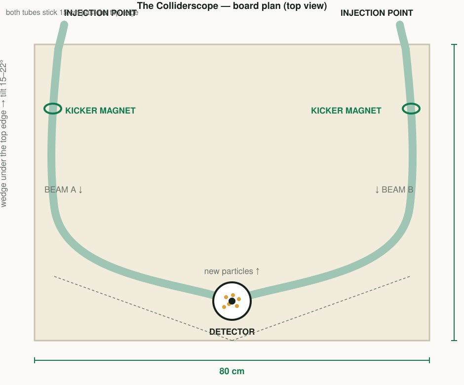

# The Colliderscope — build guide

A table-top particle collider: two steel balls race down two mirrored tracks
and crash into each other in front of a detector. Built from clear tubing, a
board, two homemade electromagnets, and a buzzer.

**It costs about £45, builds in a weekend, works offline, and is designed so
that a Year 4 child can run it themselves at a stand.**

> ### The three rules of this build
>
> 1. **Dry-fit everything with masking tape and test it with a ball BEFORE you
>    glue.** Tape is cheap. A stalled ball at the fair is not.
> 2. **The two tracks must be mirror images of each other.** Identical tracks
>    are what makes the two balls arrive together.
> 3. **Batteries only, never mains.** Everything runs on AAs at 6 V. If a part
>    only works from the wall, it is the wrong part.
>
> Read [`SAFETY.md`](SAFETY.md) before you start, and keep a printed copy in the box.

---

## 1. What you are building

One button fires both balls at the same instant. They race down their tubes in
opposite directions, round the sweeping curve, and meet in the detector cup in
the middle — **CLACK** — beads spray out as the "new particles", and the buzzer
rings.

| | |
|---|---|
| Board | MDF or plywood, 80 × 60 cm, tilted 15–22° |
| Beam pipes | 2 × clear PVC tubing, 16 mm inside diameter, mirrored |
| Protons | 14 mm steel ball bearings (must be steel — the magnets grip them) |
| Kickers | 2 × electromagnets the children wind themselves, 200 turns each |
| Launch | One button releases both coils at the same instant |
| Detector | Clear cup with coloured beads in it |
| Signal | A buzzer that fires on impact |
| Build time | 4–6 hours over a weekend (the glue needs time to cool) |
| Cost | ~£35–55, all of it from `parts_list.md` |

**Why two mirrored tracks instead of one ring?** Because in a real collider the
two beams really do travel in opposite directions and meet at a crossing point,
so this is truer to the physics than a single ring. And because it is reliable:
gravity does the accelerating, so it works on the hundredth go exactly like the
first.

---

## 2. Before you start

**Parts:** [`parts_list.md`](parts_list.md) has the full shopping list — 17
items, ~£48, nothing specialist.

**Tools:**

| Everyone | Adult only |
|---|---|
| Pencil, ruler, scissors | Hobby knife and tubing cutter |
| Masking tape (the most-used tool in the build) | Wire strippers |
| Phone stopwatch, for the tilt test | Hot glue gun |
| Felt tips and lining paper, for decorating | |

**Optional 3D printed parts.** If you have a printer, six small parts remove
the three fiddliest jobs — gripping the tube, winding the coils, and firing
both beams together. They are in [`3dprint/PRINTED_PARTS.md`](3dprint/PRINTED_PARTS.md),
with ready-to-print STLs. **Everything below works with no printer at all**;
where a printed part helps, the step says so in a *Printed part* box.

**Set-up:** clear a table, put newspaper down, and plan on two sessions —
building, then gluing once you are sure. Print the one-page checklist at the
bottom of this file and tick it off as you go.

---

## 3. The build, step by step

### Step 1 — The board and the tilt *(30 min)*

**Goal:** a board that stands tilted, and a ball that rolls its whole length in
2–4 seconds.

**You need:** board, wedge, saw and sandpaper (adult), lining paper, felt
tips, steel ball, stopwatch.

1. Cut the board to **80 × 60 cm** and sand the edges.
2. Raise the back edge on a wedge — a door wedge, a timber offcut, or a stack
   of books — so the board tilts **15–22°**.
3. Screw a batten across the bottom front edge so nothing rolls off the table.
4. Kids' job: cover the board in lining paper and draw the logo on it — two
   spirals and a starburst in the middle.
5. **Tilt test:** put a ball at the top corner and time it to the bottom. You
   want **2–4 seconds**. Faster and the crash will be violent; slower and it
   may stall. Adjust the wedge *now*.

**Done when:** the ball rolls end to end in 2–4 s, three times out of three.
**Trouble:** ball stops → board too shallow, raise the wedge.

---

### Step 2 — Draw the two tracks *(15 min)*

**Goal:** two pencil lines that are exact mirror images, both always going
downhill, both ending at the detector.

**You need:** the printed [`layout_template.html`](layout_template.html)
(print it at 100 % and copy the 10 cm grid onto the board square by square), or
a pencil and a good eye.

1. Mark the **detector** on the centre line, 8–10 cm up from the bottom edge —
   the lowest point of the whole run, so everything descends into it.
2. From the **top-left corner**, draw a sweeping curve that runs down the
   board, bows outward to the left edge, and curls back in to the detector.
   About three-quarters of a turn reads as "going round the ring".
3. **Mirror it exactly** on the right. The template has a dotted fold line down
   the middle — that symmetry is not decoration.
4. Drop a ball on each line and let it roll. If it stalls anywhere, rub the
   line out and make that section straighter or steeper.

**Done when:** both balls roll the whole way and arrive within half a second of
each other. Do not move on until this is true.
**Trouble:** a stall → that bit of the curve is climbing; straighten it.

---

### Step 3 — Lay the tubing *(45 min)*

**Goal:** both tubes taped along their lines, with the top 15 cm of each
sticking out past the top edge of the board.

> **Printed part:** `track_clip.stl` — print about 30. They grip the tube and
> reposition instantly, which makes the dry-fit stage much easier. Tape or glue
> the foot down. Print one first and test the fit on your tube; if it is tight,
> regenerate with a smaller `SQUEEZE`. Measure your tube's outside diameter
> first — flexible 16 mm ID tubing is commonly 21–22 mm outside.

**You need:** tubing (5 m), scissors or knife (adult), masking tape, ball.

1. Uncoil the tubing and leave it in a warm room for an hour, so it stops
   fighting you.
2. Cut two lengths to match your two lines, plus 15 cm spare at each end.
   **Adult job** — straight cut, and deburr the ends with sandpaper.
3. Tape each tube along its line with masking tape. Leave the top 15 cm
   sticking out past the top edge: that is the **injection point**.
4. Drop a ball in the top of tube A. Watch the whole run. Then tube B. Then
   both at once. Adjust until both runs are smooth and quiet.
5. Only now replace the tape: clips or dabs of hot glue every 15–20 cm. Leave
   the last 20 cm before the detector unclipped, so you can still nudge the
   final aim.

**Done when:** a ball dropped in each top end arrives in the cup, and the last
10 cm of each tube points **downwards into** the cup, not across the room.

---

### Step 4 — Wind the coils *(1 hour, the best bit)*

**Goal:** two identical 200-turn coils, wound on the tube, that hold a steel
ball against gravity.

> **Printed part:** `coil_mandrel.stl` — slide the tube over it, put the hex
> end in a cordless drill, and wind 200 turns in twenty seconds at slow speed.
> An adult drives the drill; a child counts the turns and keeps the tally. If
> you have no drill, wind by hand exactly as below — it works either way.

**You need:** enamelled copper wire (10 m per coil), masking tape, wire
strippers (adult), the tally chart.

1. Tape a starting tab of masking tape to the tube, sticky side out, about
   20 cm down from the top end.
2. **Kid job:** wind the wire around the tube on that spot, turns side by side
   and neat. **200 turns.** Count in tens and keep a tally.
3. Leave 25 cm of wire free at each end, then tape over the coil so it cannot
   unwind.
4. Wind the second coil the same way — **same direction, same number of
   turns.** Identical coils are what makes the two balls behave identically.
5. Strip 1 cm of insulation off all four ends (**adult job**). Enamelled wire
   looks bare but is not: sand or scrape the last 5 mm until you see bright
   copper, or the circuit will not work at all.

**Done when:** both coils are neat, taped, and the same size, with four bright
copper ends.
**Trouble:** see the coil rows in the troubleshooting table.

---

### Step 5 — Fit the gates and wire the launch *(45 min)*

**Goal:** one button that releases both balls at exactly the same moment.

Each coil is a gate: energised, it drags the ball up into its centre and holds
it at the top of the track. Press the button, the power cuts, the ball drops —
exactly like the injection kicker magnets on a real machine.

**You need:** both coils, 2 × AA battery holders, push button, wire, tape or
choc-block connectors.

1. Wire one coil to its own battery pack through the button:
   `battery + → button → coil → battery −`. Do not solder anything — twist the
   wires tightly and tape each joint, or use a choc-block.
2. **Test hold:** tilt the board, hold a ball just above the coil, press and
   hold the button. The ball should pull in and stay when you wiggle the board.
3. **Test release:** let go. The ball must drop **immediately**.
   *Stays stuck* → take off 40 turns. *Never pulls in* → add 40 turns, or the
   batteries are flat, or the insulation is still on the wire.
4. Glue or tape each coil firmly to the tube.
5. Rewire so that **one** button fires **both** coils together. That single
   shared button is the whole trick: both balls release at the same instant.

> **Printed alternative:** `ball_gate.stl` ×2 and `gate_shutter.stl` ×2.
> These need no batteries and no coils: the ball rests in the gate's cradle
> and a shutter across its path holds it. Fit one gate to each tube end,
> rotate one through 180° so both shutter tabs face the same way, and tie a
> string between the two tabs — one pull fires both beams together. Use this
> if the coils frustrate you, or as the backup that lives in the box.

> Worth saying out loud: a real accelerator's kickers switch in a few
> millionths of a second. Ours take a few hundredths. Same idea.

**Done when:** one press drops both balls together, ten times out of ten.

---

### Step 6 — The detector *(30 min)*

**Goal:** a cup dead centre of the crossing point, with beads in it and
something to stop them escaping.

**You need:** clear cup or the bottom 8 cm of a bottle, beads, paper, felt
tips, hot glue (adult).

1. Pour in a layer of beads about 1 cm deep. **Kid job.**
2. Fix the cup dead centre where the two tubes meet — sunken into a hole, or
   held in a ring of hot glue, so it cannot move.
3. Aim the last 10 cm of both tubes down into it, and re-test with balls.
4. Decorate a paper collar around it as an **ATLAS-style detector**: draw the
   inner tracker, the calorimeter and the muon chambers as coloured bands.
   The real detector really is built in concentric layers, so this is a
   talking point, not a decoration.

> **Printed parts:** `catch_funnel.stl` sits over the cup and turns bounce-outs
> into bounce-backs — the single best upgrade for a noisy fair, because a ball
> that leaves the cup takes half a minute to find. `detector_rings.stl` are
> three rings the children paint as the three detector layers.

**Done when:** ten crashes, and every ball and bead is still in the cup.

---

### Step 7 — The "we detected a collision!" buzzer *(30 min)*

**Goal:** a buzz at the moment of impact.

Build option A, and keep option B in the box as the fallback.

**Option A — impact switch (more like the real thing)**

1. Stick two strips of foil tape inside the cup, side by side, with a **2 mm
   gap**. They must not touch.
2. Wire `battery + → buzzer → foil strip 1`, and `battery − → foil strip 2`.
3. When the balls crash in, the beads and balls momentarily bridge the gap and
   it buzzes.

**Option B — the human detector (never fails, and is more fun)**

A big push button wired to the buzzer, sat next to the board. Whoever spots the
crash presses it. Announce loudly: *"The detector is a person who never
blinks!"*

**Done when:** the buzzer fires on a crash and does not fire on its own.
**Trouble:** never fires → narrow the gap. Fires on its own → widen it.

---

### Step 8 — Labels and dress rehearsal *(35 min)*

**Goal:** a machine that explains itself, and a run that never fails.

1. Print or hand-write labels and tape them on: `INJECTION POINT` ·
   `KICKER MAGNET` · `BEAM PIPE` · `BEAM A →` · `← BEAM B` · `DETECTOR` ·
   `NEW PARTICLES`. This is the single highest-value 15 minutes in the build: a
   visitor reads the labels, the kids narrate, and the model explains itself.
2. **Dress rehearsal:** run the whole thing **ten times in a row**. Every time.
   If it works 10/10, you are ready for the fair.

**Done when:** ten out of ten, and a spare battery pack in the box.

---

## 4. Troubleshooting

| Symptom | Cause | Fix |
|---|---|---|
| Ball stalls part way | Board too shallow, or the curve climbs | Steeper wedge; straighten that bit of tube; shorten the track |
| Ball stops inside the coil after release | Coil holds too strongly (remanence) | Remove turns; move the coil 1 cm along the tube; tap the board |
| Ball never pulls into the coil | Too few turns, flat batteries, or insulation still on the wire | Add turns; fresh batteries; scrape the wire ends bright |
| Balls arrive at different times | Tracks not identical, or different friction | Re-check the mirror symmetry; rub a dry PTFE or graphite pencil along the slower tube |
| Ball bounces out of the cup | Too fast, or the cup is too shallow | Reduce the tilt slightly; deeper cup; pack the beads deeper; fit the printed `catch_funnel` |
| Beads end up on the floor | No funnel, over-enthusiastic crash | Fit the funnel; keep loose beads inside the cup only (see `SAFETY.md`) |
| Clip will not grip the tube | Printed `SQUEEZE` too small for your tube | Regenerate at `SQUEEZE = 0.5`, or scale the STL to 98 % |
| Clip too tight to push on | Printed `SQUEEZE` too large | Regenerate at `SQUEEZE = 0.15`, or scale to 102 % |
| Shutter binds in the gate | Slot too tight | Regenerate with `CLEAR = 0.4`; wax the slot with a candle |
| Buzzer never fires | Foil gap too wide | Narrow the gap; or use the human-detector button |
| Buzzer buzzes on its own | Foil gap too narrow | Widen the gap |
| Everything worked yesterday, nothing today | Flat batteries | Spare battery pack in the box. Seriously — bring spares |

---

## 5. What our model is honest about

Every part of the model stands for a real thing, and the mapping is worth
saying out loud at the stand.

| Part of our model | Real machine | Honest? |
|---|---|---|
| Clear plastic tube | the beam pipe that protons travel through | ✅ directly comparable |
| Steel ball bearing | a proton (tiny, but our ball is tiny too) | ✅ |
| Two mirrored tracks, launched together | two counter-rotating beams | ✅ |
| The long sweeping curve | the ring — the beam is bent round by magnets | ✅ |
| Electromagnet gates holding each ball | the **kicker / injection magnets** that drop the beam into the ring | ✅ real: LHC beams are injected by fast kicker magnets |
| The slope / the launch speed | the **RF cavities** that give the beam its energy | 🔶 simplified — in the real machine the kick repeats every lap |
| Beads knocked out of the cup | new particles made from the crash energy | ✅ E = mc², and it is the point of the whole machine |
| The buzzer at the moment of impact | the detector's trigger signal | ✅ |
| Balls that jump out of the cup | particles escaping the detector, e.g. neutrinos | ✅ use it — it is a great line |

Things our model deliberately does **not** show. Say so if anyone asks — it
makes you sound like a scientist:

- the balls **roll**; protons do not roll;
- our balls **slow down**; the real beam gets topped up every lap by the RF
  cavities;
- our crash is a **mechanical bounce**; the real one converts energy into
  matter.

There is a much longer version of all of this in
[`docs/science_notes.md`](../docs/science_notes.md), including the physics
inside the simulation.

---

## 6. Optional upgrades

**Level 2 — steering magnets (30 min).** Wind two more coils on large nails and
mount them beside the tube near the middle, wired to their own switch. Flip the
switch and the passing ball is tugged off line — a live demonstration that
**magnets steer charged particles**. The same nail coil picks up paperclips, so
visitors can make the magnet work themselves.

**Level 3 — a real ring (2 hours).** Wind the tubing in a descending spiral
around a large plastic bucket stood upright in the middle of the board. Balls
now do three or four laps instead of one sweep, which looks much more like the
pictures of the LHC. Keep the exit aimed at the centre cup.

**Level 4 — automatic firing (a weekend, for the grown-ups).** A micro:bit or
Arduino, two IR break-beam sensors at the detector, and a MOSFET driving each
gate: the machine fires itself whenever the balls are loaded and counts
collisions on screen. Only do this if a grown-up wants the electronics project
— the Level 1 button is better for Year 4 presenters, because *they* do the
firing.

**Level 5 — the standalone electromagnet table (30 min, huge hit at fairs).**
A nail, 1 m of wire, a AA battery, a pile of paperclips and a printed card:
*"Wind 50 turns. Connect the battery. How many clips can you pick up? Now try
25 turns. More turns = stronger magnet."* This turns your stand from a show
into an activity, and it is exactly the physics that makes the LHC's magnets
work.

---

## 7. Running the stand (5-minute loop)

1. **Hook (30 s).** *"This is a model of the biggest machine humans ever built.
   It smashes tiny particles together to find out what everything is made of."*
2. **Show (60 s).** Fire it twice. Let the beads fly. Ring the buzzer.
3. **Explain (90 s).** Point at the labels, using the table in section 5.
4. **Computer (90 s).** Open [the simulation](../simulation/), turn the magnets
   down so the beam flies off, then press **COLLIDE NOW**.
5. **Hands-on (60 s).** Level 5 paperclip table, or let a visitor press the
   launch button.

Keep a tally chart: *"Collisions so far: 214."* People queue for things with
numbers on them.

---

## 8. Build checklist

Print this page. Tick every line; do not skip a test.

- [ ] **Step 1** board cut, edges sanded, batten screwed on
- [ ] **Step 1** tilt test: ball rolls end to end in 2–4 s, 3 times
- [ ] **Step 2** two mirrored track lines drawn from the template
- [ ] **Step 2** both balls roll the whole way, arriving within 0.5 s
- [ ] **Step 3** tubes taped, tops sticking 15 cm past the board edge
- [ ] **Step 3** both tubes drop a ball into the cup
- [ ] **Step 3** last 10 cm aims *down into* the cup
- [ ] **Step 4** two coils, 200 turns each, same direction, taped
- [ ] **Step 4** all four wire ends scraped to bright copper
- [ ] **Step 5** coil holds a ball; releases it instantly
- [ ] **Step 5** one button fires both balls together, 10/10
- [ ] **Step 6** cup fixed dead centre, beads in, 10 crashes with no escapes
- [ ] **Step 7** buzzer fires on a crash, not on its own
- [ ] **Step 8** labels on: injection point, kicker magnet, beam pipes, detector
- [ ] **Step 8** dress rehearsal: 10/10
- [ ] `SAFETY.md` printed and in the box
- [ ] Spare battery pack in the box
- [ ] Ball count written on the jar lid
